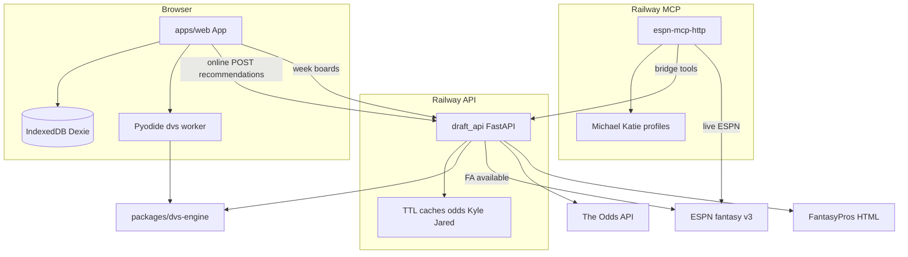

# FantasyDraftTool — full codebase analysis

**Date:** 2026-10-10  
**Branch analyzed:** `feature/A.1-nfl-week-dst-odds` (tip `f28f5cb`)  
**Method:** Multi-agent read-only audit (Wave 1: map/web/api/engine/tools/skills/git/transcripts; Wave 2: integration/CI/cloud/wishlist).  
**Companion:** [Desired features from chats](./2026-10-10-desired-features-from-chats.md) (wishlist only; implementation deferred).

---

## 1. Executive map

FantasyDraftTool is a **local-first fantasy football draft assistant** plus **in-season week tools** and a separate **ESPN Fantasy MCP** for Cursor/Claude/ChatGPT.

| Piece | Path | Role |
|-------|------|------|
| Web PWA | `apps/web` | Draft room (Zustand + Dexie), DVS recs, Week D/ST + Week K boards |
| API | `apps/api` | Stateless FastAPI: recommendations, CSV import, week odds / Kyle DST / Jared K / ESPN leagues |
| Engine | `packages/dvs-engine` | Pure Python DVS (V4 default, V5 opt-in); no I/O |
| ESPN MCP | `tools/espn-mcp` | Stdio + hosted HTTP; rosters, FA, weekly bridge tools, Ballers |
| Rankings | `tools/rankings` | Offline expert board → `apps/web/src/data/expertRankings.json` |
| Rosters snapshot | `data/rosters` | Committed ESPN export (not live MCP dependency) |

**Managers:** pnpm 9 (web), uv + Python ≥3.13 (`apps/api`, `packages/dvs-engine`; `tools/*` outside uv workspace).

**Deploy sketch (docs):** Cloudflare Pages (web) + Railway (API). **Also on this branch:** second Railway service for `espn-mcp-http`. CI tests; does not deploy.

---

## 2. Architecture + connections

**Critical facts:**

- Draft state is **browser-only** (Dexie). API does not store draft sessions.
- Recommendations: online API → offline Pyodide → TS fallback (`apps/web/src/engine/adapter.ts`).
- Week boards and MCP weekly tools share `draft_api` scrapers/caches.
- MCP bridge tools (`kyle_dst_available`, `jared_k_available`, `week_odds`) **lazy-import** `draft_api` (Docker installs it; bare tools install may not).

---

## 3. Feature catalog (shipped)

| Feature | Surface | Entry points | Tests |
|---------|---------|--------------|-------|
| Live draft + DVS recs | web + API + engine | `App.tsx`, `draftStore.ts`, `POST /api/v1/recommendations` | vitest store/adapter; engine golden; API tests |
| Offline draft scoring | web | `dvs.worker.ts`, PWA/SW | Playwright `offline.spec.ts` |
| Footballers CSV import / profiles | web | `footballersImport.ts`, Dexie `savedRankings` | import dialog / integration tests |
| Week D/ST (Kyle × FA + odds) | web + API | `WeekDstView.tsx`, `/api/v1/nfl/kyle-dst-*`, `/nfl/week-odds` | WeekDstView + API fixtures |
| Week K (Jared × FA) | web + API | `WeekKView.tsx`, `/api/v1/nfl/jared-k-*` | WeekKView + API fixtures |
| ESPN league directory | API (+ MCP) | `espn_leagues.json`, `GET /api/v1/espn/leagues` | API tests |
| ESPN MCP research tools | MCP | `espn_request`, draft/settings/players/FA/status | mcp unit tests (local; **not in CI**) |
| Live rosters + directory | MCP | `espn_league_rosters`, `espn_league_directory` | `test_rosters.py` |
| Weekly bridge tools | MCP → API | `kyle_dst_available`, `jared_k_available`, `week_odds` | no draft_bridge CI |
| Ballers latest episode | MCP | `ballers_latest` | `test_ballers.py` |
| Hosted MCP auth | MCP HTTP | bearer + OAuth (`http_app`, `oauth`) | `test_http_auth`, `test_oauth` (not in CI) |
| Rankings seed pipeline | tools | `tools/rankings/generate.py` | rankings pytest |
| Roster snapshot export | script | `export_my_rosters.py` → `data/rosters/` | manual |

**Not shipped (spec later):** Sleeper sync, accounts/Postgres, mock draft UI, opponent demand as product default, Yahoo/ESPN live draft sync in the web app.

---

## 4. Skills and MCP catalog

### Project skills (`.cursor/skills/` — mostly gitignored)

| Skill | Role |
|-------|------|
| `patrick-thorman-weekly-wr` / `thorman-wr-cross-ref` | Explicit; Comet + FantasyPros + ESPN |
| `jamie-calandro-2026-wr1-weekly-wr` / `calandro-2026-wr1-cross-ref` | Explicit; Comet + FP + ESPN |
| `start-apps` | Boot API + web |
| `simplify-everything` | Clarify / SwitchMode (tracked exception under gitignore) |

### Personal skills (`~/.cursor/skills`, Claude mirrors)

Kyle DST, Jared K, Ted Blueprint DEF, ESPN available DST, Thorman RB + cross-ref.

### MCP tools (13) + prompts

Tools: reference, request, draft_picks, league_settings, players, free_agents, status, league_rosters, league_directory, kyle_dst_available, jared_k_available, week_odds, ballers_latest.  
Prompts: `katie_roster`, `league_rosters`, `ballers_and_roster`, `week_dst_k`.

**Cloud note:** Thorman/Calandro need local Comet — not portable. Kyle/Jared/odds/rosters are portable with secrets in env.

---

## 5. Data / config / secrets (today)

| Class | Examples |
|-------|----------|
| Client-local | Dexie draft board, saved rankings, week league id in `localStorage` |
| Server secrets | `ESPN_S2`/`SWID` (+ Katie), `ODDS_API_KEY`, `MCP_AUTH_TOKEN*`, login passwords |
| Committed | `expertRankings.json`, `espn_leagues.json`, `data/rosters/*` |
| Ephemeral | Per-process Odds/Kyle/Jared TTL caches |

Env shape: root `.env.example`, `apps/web/.env.example`, `tools/espn-mcp/.env.example`. Used but undocumented: `MCP_LOGIN_PASSWORD_KATIE`.

**Do not commit** real `.env`, cookies, or tokens. `.cursor/` is gitignored (local MCP/skills).

---

## 6. Git evolution timeline

~44 commits (2026-08 → 2026-10-10). Epochs:

1. Seed / bootstrap  
2. DVS maturation (V2→V5) — `master` tip `18aebc4`  
3. Footballers import / ranking profiles  
4. Week D/ST + Week K + ESPN FA (`3a5e1e1`…`d688bc8`)  
5. ESPN MCP local (`f87eb60`)  
6. Hosted MCP + rosters + Ballers — **`f28f5cb`** on A.1 (**10 commits ahead of master**)

---

## 7. Spec vs reality

| PROJECT_SPEC | Reality |
|--------------|---------|
| TypeScript engine under `/src` | Python `dvs-engine` + Pyodide; TS is fallback only |
| Client-only MVP | FastAPI preferred online; week boards require API |
| Phase 2 Sleeper / Phase 3 mock UI | Not shipped |
| Accounts / Postgres | Explicitly later |

Prefer `docs/architecture.md` + this audit over PROJECT_SPEC §7–9 for planning.

---

## 8. Test and CI gaps

**In CI:** dvs-engine, draft_api, rankings, web vitest, Playwright e2e, ruff, mypy (engine+api).

**Not in CI:** `tools/espn-mcp` tests (oauth/http_auth/rosters/bridge), live network scrapes, mypy on tools.

**Risk:** Hosted MCP and `draft_bridge` can break without failing Actions.

---

## 9. Risk register (ranked)

1. **Unauthenticated public API** — CORS is browser-only; Odds/ESPN keys burnable if URL leaks (I fact / J Phase-1).  
2. **ESPN cookie expiry** — private FA/MCP 503s.  
3. **CI blind spot** on espn-mcp.  
4. **Scrape fragility** — FantasyPros HTML, Ballers, Odds quota.  
5. **Railway cold start** during live drafts.  
6. **Dual Railway version skew** (API vs MCP images).  
7. **Silent TS fallback** quality drop if Pyodide/API fail.  
8. **Credential leakage in chat transcripts** (historical).  
9. **Doc/branch drift** (`master` vs A.1; PROJECT_SPEC).  
10. **WR skills non-portable** (Comet) if treated as Day-0 cloud blockers.

---

## 10. Cloud and multi-user readiness

**Day-0 service split (do not merge API + MCP):**

1. Cloudflare Pages — `apps/web` (keep SW/Pyodide/wheel)  
2. Railway A — draft API (warm on draft weekends)  
3. Railway B — `espn-mcp-http` (token/OAuth gated)

**Multi-user (household):**

- Web draft: one browser = one room (no sync).  
- Web week FA: uses **API** cookie pair (typically Michael).  
- MCP: Michael vs Katie profiles already.

**Postgres:** only when multi-device draft sync or accounts are required.

Full decision matrix and security phases: see Agent J synthesis in section 11–12.

---

## 11. Phased security roadmap

| Phase | Actions |
|-------|---------|
| **Day-0** | MCP tokens + strong passwords; secrets in Railway only; CORS allowlist; accept open API recommend/week behind CORS for household |
| **Phase-1** | Optional API Bearer on week/ESPN routes; cookie refresh runbook; tighter error redaction; optional Pages Access wall |
| **Phase-2** | Accounts + Postgres sync; per-user ESPN linkage; retire shared API cookie for all browsers |

---

## 12. Recommended next cloud moves (ordered)

1. Deploy from **A.1** (or merge A.1 → master) so week + MCP tip is what ships.  
2. Stand up **API on Railway** with CORS + Odds + ESPN cookies; warm for drafts.  
3. Stand up **Pages** with `VITE_API_BASE_URL`; verify offline Playwright against prod.  
4. Stand up **espn-mcp-http** if Claude/ChatGPT household use is Day-0; set `MCP_PUBLIC_URL` + dual profiles.  
5. Add espn-mcp to CI (or smoke job).  
6. Document Katie login password env in `.env.example`.  
7. Defer Postgres, WR Comet cloud port, and Katie one-shot waiver productization until after usable deploy.

---

## 13. Open decisions for Michael

1. Day-0 cut: full stack (Pages + API + MCP) or web+API only with MCP stdio local?  
2. API ESPN cookies: Michael-only vs how Katie FA works on web week boards?  
3. Accept public API behind CORS for now, or require Phase-1 Bearer before sharing Pages URL?  
4. Always-on Railway for draft season — yes/no?  
5. First deploy branch: A.1 vs cherry-pick draft-only from master?

---

## 14. Chat-derived opportunities

Cursor transcripts (~31 sessions) show a strong **Katie / Girls Who Ball weekly ops** pattern: roster + FA + expert cross-refs (DST → K → RB → WR) + Ballers briefings + hosted MCP.

**Highest-value gaps (see wishlist doc):**

- One-shot **Katie weekly waiver briefing** (orchestration)  
- WR Thorman/Calandro as productized surface (today skill-only)  
- Ballers → team-specific briefing beyond `ballers_latest`
- **Player intelligence dashboard** — unify Clay shadow F/R, FootClan SoS, Ballers notes, news/Sunday status, ESPN roster/FA on one player view  
- **Sunday morning inactive checklist** automation  
- FootClan SoS chart + Mike Clay WR shadow ingest  
- Perplexity project / Deep Research as complementary research surface (not a replacement for live MCP)  
- **Apple Notes “Fantasy Ideas”** — injury impact model, attribute ledger / “why this week?”, RB starter↔handcuff graph  
- **Shared Katie↔Michael research inbox** — triage queue beyond Apple Notes

DST/K/odds/rosters are **already** on API/MCP/web; chats still use skills for glue.

→ Full table + addenda: [2026-10-10-desired-features-from-chats.md](./2026-10-10-desired-features-from-chats.md)

---

## How to use this audit

1. Cloud deploy decisions → sections 10–13.  
2. What to build next for weekly ops → companion wishlist (implementation TBD).  
3. Agent orientation → root `AGENTS.md` (points here).  
4. Prefer code + this audit over stale PROJECT_SPEC engine chapters.
